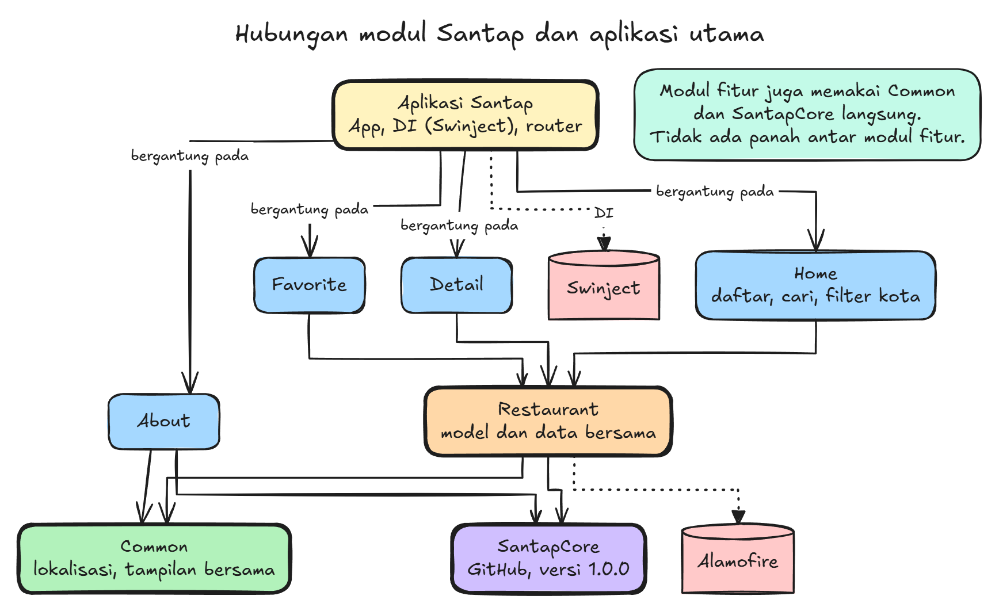
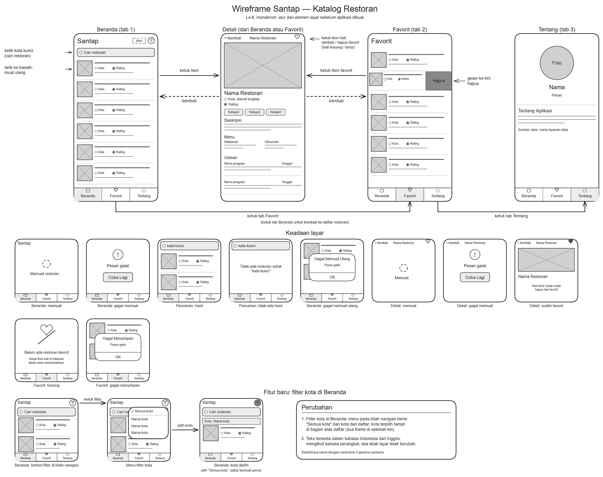

# Santap

[](https://github.com/jeffrymahbuubi-dicoding/Santap-iOS/actions/workflows/ci.yml)

Santap adalah aplikasi iOS (SwiftUI) untuk menjelajahi restoran: daftar dan pencarian, filter kota, detail, restoran favorit
yang tersimpan di perangkat, serta halaman profil pembuat. Teks aplikasi tersedia dalam bahasa Indonesia dan Inggris.
Aplikasi dipecah menjadi beberapa modul Swift Package dan diuji otomatis oleh GitHub Actions.

## Cara menjalankan

1. Buka `Santap.xcodeproj` di Xcode (iOS 16 atau lebih baru).
2. Tunggu Xcode mengambil paket (termasuk `SantapCore` dari GitHub), lalu pilih scheme `Santap` dan sebuah simulator iPhone.
3. Jalankan dengan Command-R. Uji unit dan uji modul dengan Command-U.

Dari terminal, uji satu modul:

```
cd Modules/Home
xcodebuild test -scheme Home -destination 'platform=iOS Simulator,name=<nama simulator>'
```

## Continuous Integration

Workflow `.github/workflows/ci.yml` berjalan pada setiap push ke `main`, pull request, dan secara manual:

- `Lint`: `swiftlint lint --strict`.
- `Build and test`: memilih simulator iPhone yang tersedia, menguji semua modul, lalu `clean build test` untuk aplikasi
  (tanpa UI test), dan menampilkan tabel code coverage pada ringkasan job.

## Modul



| Modul | Isi |
|-------|-----|
| `SantapCore` | Protokol generik (use case, repository, data source, mapper), `Interactor`, dan presenter. Modul terpisah: [SantapCore](https://github.com/jeffrymahbuubi-dicoding/SantapCore), versi 1.0.0 |
| `Common` | Teks lokal (Indonesia dan Inggris) dan komponen tampilan bersama |
| `Restaurant` | Model, jaringan, penyimpanan Core Data, dan pemetaan data restoran yang dipakai bersama |
| `Home` | Daftar, pencarian, dan filter kota |
| `Detail` | Detail restoran dan tombol favorit |
| `Favorite` | Daftar restoran favorit |
| `About` | Profil pembuat |

Setiap fitur adalah satu modul di `Modules/`. Modul fitur tidak saling mengimpor; aplikasi utama menyambungkannya
(injeksi dependensi dengan Swinject hanya ada di aplikasi) dan mengatur navigasi.

## Wireframe


